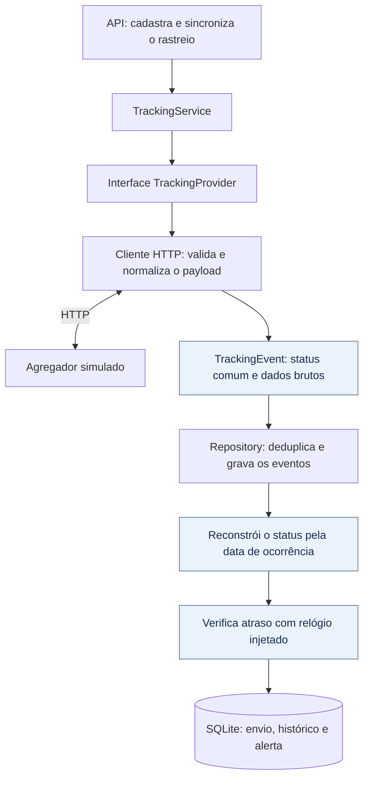

# Rastreamento de produtos enviados a criadores

[](https://github.com/leonardoperin14/conty-challenge-07-rastreio/actions/workflows/ci.yml)

API para cadastrar códigos de rastreio, consultar um agregador HTTP simulado e acompanhar status, histórico e alertas de atraso. Os códigos de cada transportadora são convertidos para um formato comum antes de chegar à regra de negócio.

**TypeScript · Node.js 24.15+ · Hono · SQLite · Vitest**

## Execução

```bash
npm ci
npm run typecheck
npm test
npm run build
```

Inicie o agregador e a API em terminais separados:

```bash
# Terminal 1
npm run dev:aggregator

# Terminal 2
npm run dev
```

A API fica em `http://localhost:3000` e o agregador em `http://localhost:4001`. Após o build, os comandos equivalentes são `npm run start:aggregator` e `npm start`.

| Variável | Padrão | Descrição |
| --- | --- | --- |
| `PORT` | `3000` | Porta da API |
| `DATABASE_PATH` | `./data/tracking.sqlite` | Banco SQLite; aceita `:memory:` |
| `DELAY_THRESHOLD_HOURS` | `72` | Limite de atraso padrão |
| `AGGREGATOR_URL` | `http://localhost:4001` | Endereço do agregador |
| `AGGREGATOR_PORT` | `4001` | Porta do servidor simulado |

## Fluxo e integração



O serviço recebe a interface [`TrackingProvider`](src/integrations/tracking-provider.ts), com os métodos `register` e `getEvents`. O [`MockAggregatorHttpClient`](src/integrations/mock-aggregator-client.ts) concentra HTTP, validação, códigos das transportadoras e normalização de datas.

Para trocar o agregador, implemente a interface em outro adaptador e injete-o no serviço. O domínio continua recebendo `TrackingEvent`, sem precisar conhecer `tracking_number`, `code` ou outros campos externos. O payload bruto é preservado para consulta.

## API e demonstração

| Método | Rota | Descrição |
| --- | --- | --- |
| `GET` | `/health` | Estado da API |
| `POST` | `/shipments` | Cadastra código, transportadora e limite opcional |
| `POST` | `/shipments/:id/sync` | Busca eventos e atualiza o envio |
| `GET` | `/shipments/:id` | Consulta status, início do trânsito e atraso atual |
| `GET` | `/shipments/:id/events` | Consulta histórico normalizado e dados brutos |
| `POST` | `/shipments/:id/check-delay` | Verifica atraso e registra ou resolve o alerta |
| `GET` | `/shipments/:id/alerts` | Consulta horários de detecção e resolução |

```bash
curl -X POST http://localhost:3000/shipments \
  -H 'Content-Type: application/json' \
  -d '{"trackingCode":"DEMO-OUT-OF-ORDER","carrier":"mock_express","delayThresholdHours":72}'

curl -X POST http://localhost:3000/shipments/ID/sync
curl http://localhost:3000/shipments/ID
curl http://localhost:3000/shipments/ID/events
```

Substitua `ID` pelo `shipment.id` retornado. O cadastro retorna `201`; repeti-lo retorna `200`. O limite fica salvo no envio: omiti-lo em um novo cadastro preserva o existente; informar outro valor retorna `409`.

| Código de demonstração | Cenário | Transportadora |
| --- | --- | --- |
| `DEMO-OUT-OF-ORDER` | Eventos fora de ordem | `mock_express` |
| `DEMO-UNKNOWN` | Código inventado pela transportadora | `mock_express` |
| `DEMO-DELIVERED` | Entrega concluída | `mock_express` |
| `DEMO-DELAYED` | Envio sem entrega, além do limite | `mock_express` |
| `DEMO-POSTAL` | Segundo conjunto de códigos | `mock_postal` |

Os eventos de demonstração usam datas fixas de agosto de 2025. Envios não entregues podem aparecer atrasados ao executar com o relógio atual; os testes controlam a data explicitamente.

Erros retornam `{ "error": { "code": "...", "message": "..." } }`: `400` para entrada inválida, `404` para envio ou código remoto inexistente, `409` para conflito de configuração, `502` para falha ou payload inválido do agregador e `504` para timeout. O cliente HTTP usa timeout de cinco segundos.

## Payload bruto e normalização

O agregador aceita cadastro em `POST /trackings` e consulta em `GET /trackings?carrier=...&tracking_number=...`. Exemplo da resposta externa:

```json
{
  "tracking_number": "BR123456789",
  "carrier": "mock_express",
  "events": [
    {
      "id": "evt-100",
      "code": "POD_OK",
      "description": "Entregue",
      "timestamp": "2025-08-04T08:00:00Z"
    }
  ]
}
```

O adaptador transforma esse evento no formato usado pela aplicação. Exemplo, recebido em 05/08:

```json
{
  "eventKey": "external:evt-100",
  "externalEventId": "evt-100",
  "rawStatus": "POD_OK",
  "normalizedStatus": "DELIVERED",
  "occurredAt": "2025-08-04T08:00:00.000Z",
  "receivedAt": "2025-08-05T12:00:00.000Z",
  "description": "Entregue",
  "rawPayload": {
    "id": "evt-100",
    "code": "POD_OK",
    "description": "Entregue",
    "timestamp": "2025-08-04T08:00:00Z"
  }
}
```

| Status comum | Exemplo `mock_express` | Exemplo `mock_postal` |
| --- | --- | --- |
| `POSTED` | `OBJ_POSTED` | `POSTAGEM_CONFIRMADA` |
| `IN_TRANSIT` | `MOVING` | `EM_TRANSFERENCIA` |
| `OUT_FOR_DELIVERY` | `ON_ROUTE` | `SAIU_PARA_ENTREGA` |
| `DELIVERED` | `POD_OK` | `ENTREGA_REALIZADA` |
| `EXCEPTION` | `ADDRESS_PROBLEM` | `ENDERECO_INCORRETO` |

**Status desconhecido não vira entregue.** Um código como `AWAITING_DRONE_PICKUP` fica com `rawStatus` preservado e `normalizedStatus: null`. Ele aparece no histórico, mas não altera o status conhecido do envio. Se todos os eventos forem desconhecidos, o status permanece `null`.

## Eventos fora de ordem e histórico

A cada sincronização, o status é reconstruído a partir de todo o histórico, ordenado por `occurredAt`, com desempate estável por status e chave do evento. A ordem de chegada da resposta não decide o estado atual.

Por exemplo, receber primeiro “saiu para entrega” e depois uma postagem mais antiga mantém `OUT_FOR_DELIVERY`. As etapas normais não retrocedem e `DELIVERED` é terminal. Uma exceção aparece como `EXCEPTION` e pode ser resolvida por evento posterior da mesma etapa ou de uma etapa superior.

**Consultar novamente não duplica o histórico.** O cadastro é único por provedor, transportadora e código. Cada evento é único por envio e `eventKey`: usa o ID externo, quando disponível, ou um hash de transportadora, código de rastreio, status bruto e instante normalizado.

A resposta do sync diferencia `receivedEvents` de `insertedEvents`. Repetir a mesma resposta mantém os eventos e retorna zero inserções. Se o agregador reutilizar a identidade de um evento com status ou instante diferentes, a transação é revertida com `EVENT_ID_CONFLICT`.

## Detecção de atraso

O marco inicial é o evento mais antigo de **postagem ou trânsito**. O envio está atrasado somente quando há esse marco, ainda não existe entrega conhecida e o tempo decorrido **ultrapassa** o limite configurado.

| Situação com limite de 72 horas | `isDelayed` |
| --- | --- |
| Exatamente 72 horas desde o marco inicial | `false` |
| 72 horas e 1 milissegundo, sem entrega | `true` |
| Entrega conhecida, mesmo consultada dias depois | `false` |
| Sem evento de postagem ou trânsito | `false`, sem marco para calcular |

Isso evita marcar uma entrega normal como atrasada só porque a consulta aconteceu depois. O cálculo usa os eventos conhecidos: uma entrega ainda não informada pelo agregador não pode ser presumida.

Sincronizar ou chamar `check-delay` registra um único alerta por envio, com `detectedAt`. Quando chega uma entrega, o alerta é resolvido com `resolvedAt`. A consulta do envio calcula `isDelayed` com o relógio atual, mas não cria um alerta por si só.

## Testes

| Comportamento | Cobertura existente |
| --- | --- |
| Eventos fora de ordem | A projeção coincide com a sequência cronológica e mantém a etapa correta |
| Status inventado | Domínio e adaptador preservam o desconhecido sem marcar entrega |
| Consulta repetida | Primeiro sync insere eventos; o segundo insere zero |
| Atraso com data controlada | Relógio injetado testa 72 horas exatas, mais 1 ms e resolução após entrega |
| Entrega normal consultada depois | Não cria falso alerta de atraso |
| Integração substituível | Testes usam um provedor falso e também o cliente HTTP com o agregador simulado |
| Persistência | Cadastro e histórico sobrevivem à reabertura do SQLite |

Os testes estão em [`tests/domain.test.ts`](tests/domain.test.ts) e [`tests/integration.test.ts`](tests/integration.test.ts). A validação registrada no README anterior incluía typecheck, testes, build e uma verificação com os dois processos ativos. Nesta atualização documental, esses comandos não foram executados novamente. O workflow de CI executa instalação, typecheck, testes e build em Ubuntu com Node.js 24, a cada push ou pull request.

## Limitações

O agregador é simulado e conserva seus dados em memória. Não há integração com uma transportadora real, tarefa periódica, e-mail ou webhook: a verificação e os alertas ficam disponíveis pela API.

Sem ID externo, ocorrências com os mesmos campos usados no hash são indistinguíveis. O atraso considera o tempo total desde postagem ou primeiro trânsito; não usa prazo prometido por transportadora nem dias úteis. Uma entrega conhecida encerra o atraso atual, sem classificar retroativamente se ela chegou dentro do prazo.

## Uso de IA e revisão

Usei o Codex para implementar a API, o cliente HTTP do agregador, as regras de status e atraso, a persistência e os testes. Também usei IA na documentação, na revisão técnica e na criação do workflow de CI.

Nesta etapa, revisei a organização e as explicações do README e pedi ajustes para deixar o funcionamento mais claro. A conferência técnica do código e a execução das validações foram feitas pela IA; não fiz revisão linha a linha nem executei os testes manualmente.
